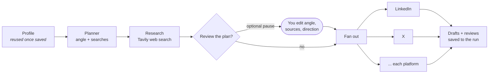
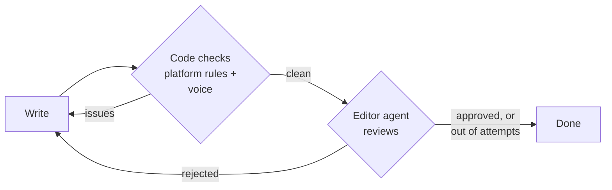
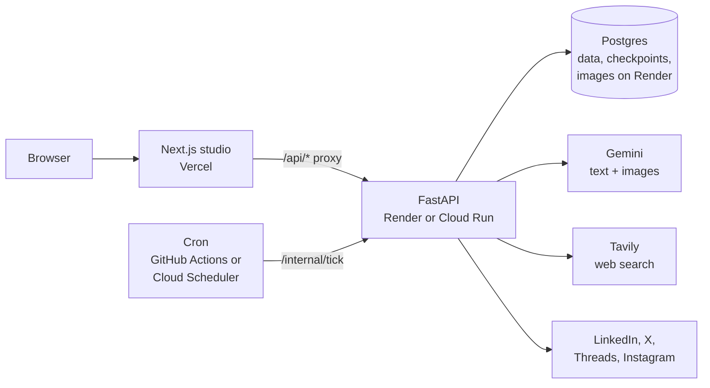

# Brand Bot

[](https://github.com/coderxtushar/BrandBot-Ai-Agent/actions/workflows/ci.yml)

Brand Bot is an AI content team for your personal brand. You describe who you are and who you write for. It
researches a timely angle on the web, writes posts for **LinkedIn, X, Threads, Instagram, Medium and YouTube
Shorts** in your voice, has an editor agent review every draft, and then publishes or schedules them to your
connected accounts. Results come back as analytics, and the next run learns from what worked.

It is a full-stack project: a LangGraph agent with Gemini and Tavily, a FastAPI backend that streams progress
live, and a Next.js studio app, deployable for free (Render + Neon + Vercel) or on Google Cloud Run.

---

## Contents

- [What using it looks like](#what-using-it-looks-like)
- [Features](#features)
- [How the agent works](#how-the-agent-works)
- [Architecture](#architecture)
- [Quick start](#quick-start)
- [Configuration](#configuration)
- [Connecting social accounts](#connecting-social-accounts)
- [Deploying](#deploying)
- [Limits and running costs](#limits-and-running-costs)
- [Project structure](#project-structure)
- [Adding a platform](#adding-a-platform)
- [Testing and CI](#testing-and-ci)
- [Troubleshooting](#troubleshooting)
- [API reference](#api-reference)

---

## What using it looks like

1. **Describe your brand once**: audience, expertise, tone, content pillars, and ideally 5-10 posts you wrote
   yourself. Brand Bot turns this into a brand profile (positioning, voice do's and don'ts, hashtag bank) that you
   can edit.
2. **Pick platforms and press Write.** Optionally give a topic, or let it pick a timely angle. You watch each step
   live: profile, planning, research, then every platform being written and reviewed in parallel.
3. **Review the drafts.** Each one comes with the editor's verdict and a native preview (a LinkedIn post, an X
   thread, an Instagram carousel...). Approve, edit by hand, or ask for a rewrite ("shorter", "punchier", or your
   own instruction). Every change is a version you can restore.
4. **Add a visual** if you like: an on-brand image at the platform's aspect ratio.
5. **Publish now or schedule** to your connected LinkedIn, X, Threads or Instagram account. Medium and Shorts are
   copy / export (they have no posting API).
6. **See what worked.** Stats come back from the platforms; the calendar shows everything scheduled and
   published; the best posts and topics feed into future runs.

## Features

| Area | What you get |
|---|---|
| **Writing** | Six platforms, each with its own format, style guide and hard rules (length limits, hashtag counts). One to three variants per platform. Research from the live web, cited where the format allows. |
| **Quality control** | An editor agent reviews every draft for hook, voice, platform fit, factual support and brand safety, and sends weak drafts back for a rewrite. Code checks catch broken rules and machine-sounding writing (formula hooks, "Here's how", corporate words, engagement-bait endings) and quote the exact phrase back to the writer. |
| **Your voice** | Learns from your past posts and, once you publish, from your best-performing ones. You can edit the brand profile directly. |
| **Human in the loop** | Optionally pause after research to change the angle, drop sources or add direction before anything is written. Paused runs survive restarts. |
| **Editing** | Approve or reject, edit in a form built from the platform's format, AI rewrites, fresh drafts, full version history with restore. |
| **Visuals** | An art-director step writes an image brief in your brand's style; Gemini generates it at the right aspect ratio (1:1 LinkedIn, 16:9 X and Medium, 4:5 Threads and Instagram, 9:16 Shorts). |
| **Publishing** | OAuth connections to LinkedIn, X, Threads and Instagram, tokens encrypted at rest and refreshed automatically. Publish now or schedule; each due post is claimed atomically so it never goes out twice, and temporary failures are retried. |
| **Calendar and analytics** | Month calendar with drag-to-reschedule. Stats read back from X, Threads and Instagram; typed in for LinkedIn (it doesn't share personal post stats with apps). Totals, trends, platform and topic comparisons, a posting-time heatmap and top posts. |
| **Accounts and safety** | Email and password sign-in (argon2), HTTP-only session cookies, CSRF origin checks, per-user limits on AI calls and per-IP limits on sign-in. |
| **Operations** | Docker images, one-command local stack, CI, LangSmith tracing, JSON logs with request ids, health and readiness probes, startup checks that refuse unsafe production settings. |

## How the agent works

A run is a LangGraph graph. The shared steps run once; then every chosen platform gets its own writer and
editor, running in parallel.



Inside each platform branch:



| Step | What happens | Model calls |
|---|---|---|
| **Profile** | Turns your raw brand notes and past posts into a structured profile. Skipped while your input is unchanged. | 1 (first run only) |
| **Planner** | Picks one specific angle for today and plans 2-3 web searches. Knows which topics performed best for you. | 1 |
| **Research** | Runs the searches. Results go into prompts as delimited, untrusted data, so instructions hidden in web pages are ignored. | 0 (Tavily) |
| **Plan review** | Optional pause (`interrupt()`): you adjust the plan, then the run resumes from a checkpoint. | 0 |
| **Write** | Writes in your voice with the platform's style guide, the research, your past posts and your best performers. | 1 per attempt |
| **Code checks** | Character limits, hashtag counts, and machine-sounding phrasing. Failures go straight back to the writer without paying for a review. | 0 |
| **Editor** | Strict review: hook, voice, platform fit, facts backed by research, brand safety, sounds like a person. Specific, quotable issues. | 1 per attempt |

By default a run allows two revisions per platform (`MAX_REVISIONS`). A rewrite you ask for is a single write
and review (`REWRITE_MAX_REVISIONS=0`), because you steer the next change yourself. Every model call returns a
Pydantic model ([backend/schemas.py](backend/schemas.py)), so the app never parses free text.

## Architecture



- **One origin for the browser.** The web app proxies `/api/*` to the API, so the session cookie is first-party
  on any host and there is no CORS to manage.
- **Live progress** streams over Server-Sent Events, with a keep-alive every 15 seconds so proxies don't drop
  long runs.
- **Scheduled posts** are published by a cron that calls `/internal/tick` (with a secret). Locally an in-process
  scheduler does the same.
- **Storage.** SQLite works out of the box; Postgres in production (Alembic migrations). Images go to local disk,
  Google Cloud Storage, or the database, depending on the host.

| Layer | Technology |
|---|---|
| Agent | LangGraph, LangChain, Gemini (`gemini-3.5-flash`, image: `gemini-3.1-flash-image`), Tavily |
| API | FastAPI, SSE (sse-starlette), Pydantic 2, SQLAlchemy 2 (async), Alembic |
| Web | Next.js 16, React, Tailwind 4, shadcn/ui, Framer Motion, TanStack Query |
| Data | SQLite or Postgres (Neon, Cloud SQL, Supabase) |
| Ops | Docker, Docker Compose, GitHub Actions, Render, Vercel, Cloud Run, LangSmith |

## Quick start

You need **Python 3.11-3.13** (with [uv](https://docs.astral.sh/uv/) or pip) and **Node 24**.

### 1. Try it without any API keys (demo mode)

Demo mode returns realistic canned content with real streaming, and simulates publishing, so you can explore the
whole app for free.

```bash
# API
uv venv --python 3.12 .venv && uv pip install -r requirements-dev.txt
cp .env.example .env
echo "DEMO_MODE=true" >> .env
.venv/bin/uvicorn backend.main:app --reload --port 8000

# Web app (second terminal)
cd frontend && npm install
cp .env.example .env.local        # API_ORIGIN=http://localhost:8000
npm run dev                       # open http://localhost:3000 and sign up
```

### 2. Use real AI

Get a Gemini key from [Google AI Studio](https://aistudio.google.com/apikey) and a Tavily key from
[tavily.com](https://app.tavily.com), put them in `.env`, and remove `DEMO_MODE`:

```bash
GOOGLE_API_KEY=...
TAVILY_API_KEY=...
```

### 3. Or run the whole stack in Docker

Postgres, migrations, API and web app in one command:

```bash
DEMO_MODE=true docker compose up -d --build     # http://localhost:3000
```

Ports can be changed with `WEB_PORT`, `API_PORT` and `POSTGRES_PORT`. Interactive API docs are at
`http://localhost:8000/docs` in development.

## Configuration

All settings are environment variables, read from `.env` (API) and `frontend/.env.local` (web app). Every option
is listed with a comment in [.env.example](.env.example). The ones you are most likely to touch:

| Variable | Default | What it does |
|---|---|---|
| `GOOGLE_API_KEY`, `TAVILY_API_KEY` | | AI and web research. Not needed with `DEMO_MODE=true`. |
| `DEMO_MODE` | `false` | Canned AI output and simulated publishing. |
| `DATABASE_URL` | SQLite file | Postgres URL; a host's `postgres://...?sslmode=require` string works as pasted. |
| `SECRET_KEY` | dev value | Encrypts the platform tokens stored for connected accounts. Must be long and random in production. |
| `WEB_URL`, `API_PUBLIC_URL` | localhost | Where the web app and API are reachable (OAuth callbacks, image links). |
| `GEMINI_MODEL`, `GEMINI_REVIEW_MODEL` | `gemini-3.5-flash` | Writer and editor models. |
| `GEMINI_THINKING_LEVEL` | `low` | How much Gemini thinks per call. Higher is slower on every call. |
| `MAX_REVISIONS` / `REWRITE_MAX_REVISIONS` | `2` / `0` | Automatic revise-and-review rounds for runs / for rewrites you ask for. |
| `MEDIA_BACKEND` | `local` | Where images live: `local` disk, `gcs` bucket, or `db` (Postgres). |
| `SCHEDULER_ENABLED`, `CRON_SECRET` | `true`, empty | In-process scheduler, or a cron calling `/internal/tick` with this secret. |
| `RATE_LIMIT_RUNS` etc. | `10/hour,40/day` | Per-user limits on AI runs, rewrites and images; per-IP on sign-in and sign-up. |
| `LANGSMITH_TRACING`, `LANGSMITH_API_KEY` | off | Traces every run, rewrite and image with cost and latency. |
| `ENVIRONMENT` | `development` | `production` refuses to start with unsafe settings (default secret, insecure cookies, demo mode). |
| `API_ORIGIN` (web app) | `http://localhost:8000` | Where the web app proxies `/api/*`. Read at build time. |

## Connecting social accounts

Publishing needs one developer app per platform, created under your own account. Set its OAuth callback to

```
<WEB_URL>/api/connections/<platform>/callback        e.g. https://your-app.vercel.app/api/connections/linkedin/callback
```

and add its credentials to the API's environment. Until then, that platform's **Connect** button stays disabled
with a note saying which keys are missing.

| Platform | Where | Set up | Variables |
|---|---|---|---|
| LinkedIn | developer.linkedin.com | Needs a LinkedIn Page to own the app (a placeholder page is fine). Verify the app with the page, add the products "Sign In with LinkedIn using OpenID Connect" and "Share on LinkedIn". Posts go to your personal profile. | `LINKEDIN_CLIENT_ID`, `LINKEDIN_CLIENT_SECRET` |
| X | developer.x.com | User authentication: OAuth 2.0, type "Web App". Threads are posted as text. Check X's API plan for posting limits. | `X_CLIENT_ID`, `X_CLIENT_SECRET` |
| Threads | developers.facebook.com | Use case "Access the Threads API". | `THREADS_APP_ID`, `THREADS_APP_SECRET` |
| Instagram | developers.facebook.com | "Instagram API with Instagram login"; needs a Business or Creator account. Posts need an image (converted to JPEG). | `INSTAGRAM_APP_ID`, `INSTAGRAM_APP_SECRET` |

While an app is in development mode, only your own accounts (and testers you add) can connect, which is all a
personal brand needs. Instagram and Threads fetch images from `API_PUBLIC_URL`, so it must be a public https
address for image posts.

## Deploying

The web app goes on **Vercel** either way. For the API there are two ready paths.

### Option A: free, no card (Render + Neon + Vercel)

```
browser -> Vercel (web) --/api/*--> Render free (API) --> Neon Postgres (data and images)
GitHub Actions, every 15 min --> /internal/tick
```

1. **Database.** Create a [Neon](https://neon.tech) project, turn connection pooling off, and copy the connection
   string.
2. **API.** In Render: New > Blueprint > this repo. [render.yaml](render.yaml) configures everything (free plan,
   Singapore, images in Postgres, migrations on start). Render asks for `DATABASE_URL`, `GOOGLE_API_KEY`,
   `TAVILY_API_KEY` and `CRON_SECRET` (any long random string: `openssl rand -hex 24`). Change the `vercel.app`
   addresses in `render.yaml` to yours first.
3. **Web.** Import the repo in Vercel with Root Directory `frontend` and set `API_ORIGIN` to the Render URL.
4. **Scheduled posts.** Add the GitHub repository secrets `BRANDBOT_API_URL` (the Render URL) and
   `BRANDBOT_CRON_SECRET` (the same `CRON_SECRET`). [tick.yml](.github/workflows/tick.yml) then publishes due
   posts every 15 minutes.
5. **Per-IP limits.** Call `GET <web app>/api/internal/client-ip` with `Authorization: Bearer <CRON_SECRET>` and
   set `TRUSTED_PROXY_HOPS` so `client_ip` is your own address. It is `4` for Vercel in front of Render.

After that, every push to `main` redeploys: Vercel rebuilds the web app, and Render rebuilds the API when
backend files change.

### Option B: Google Cloud Run

[deploy/cloudrun.sh](deploy/cloudrun.sh) creates the bucket, service account and secrets, builds the image, runs
migrations as a Cloud Run job, deploys the API and creates a Cloud Scheduler job. Fill in
`deploy/secrets.env` (copy [the example](deploy/secrets.env.example); git ignores it) and run:

```bash
./deploy/cloudrun.sh
```

Then point Vercel's `API_ORIGIN` at the URL it prints. Cloud Run needs a Google Cloud billing account. Images go
to Cloud Storage, and on Neon's free plan use `TICK_SCHEDULE="*/15 * * * *"` so the database can sleep.

### Self-hosting

The two Dockerfiles (`Dockerfile` for the API, `frontend/Dockerfile` for the web app) run anywhere, and
[docker-compose.yml](docker-compose.yml) is a working single-machine setup. Put HTTPS in front and set
`ENVIRONMENT=production`, `COOKIE_SECURE=true` and a real `SECRET_KEY`.

## Limits and running costs

Everything above can run at no cost, with these trade-offs:

- **Gemini free tier.** Google allows about **20 requests per model per day** on a free key. A run for two
  platforms uses about 5 (up to about 14 with revisions), a rewrite 2. When the limit is reached the app says so
  immediately; it resets at midnight Pacific time. **Image generation is not in the free tier at all** and needs
  billing on the key's Google project.
- **Tavily free plan**: 1,000 searches a month; a run uses 2-3.
- **Render free plan**: the API sleeps after 15 idle minutes, so the first request after a break takes about a
  minute. Its disk is wiped on restart, which is why images are stored in Postgres there.
- **Neon free plan**: 100 compute hours a month and 0.5-1 GB storage; the database sleeps when idle, which the
  15-minute tick allows.
- **Scheduled posts** go out within about 15 minutes of their time on the free setup (every minute on Cloud Run).
- **Speed.** Each Gemini call takes roughly 15-30 seconds, so a full run takes a few minutes; progress is shown
  live the whole time.

## Project structure

```
backend/
  main.py              FastAPI app: startup checks, middleware, routers, the local scheduler
  config.py            every setting, with production safety checks
  schemas.py           Pydantic models for brands, plans, drafts and each platform's post format
  agents/
    graph.py           the LangGraph run graph and the per-platform write -> check -> review loop
    prompts.py         prompts for profile, planner, writer, editor and image briefs
    voice.py           detection of machine-sounding phrasing, shared by prompts and checks
    checkpoint.py      durable checkpoints for paused runs (SQLite or Postgres)
  platforms/specs.py   one spec per platform: format, style guide, hard rules, preview renderer
  api/                 HTTP routes: auth, brands and runs, drafts, images, connections, publications,
                       analytics, internal (cron)
  publishing/          OAuth and posting clients for LinkedIn, X and Meta (Threads, Instagram),
                       plus the scheduler that publishes due posts and collects stats
  services/            Gemini, Tavily and image clients, media storage, demo-mode fakes
  db/                  SQLAlchemy models, repositories, Alembic migrations
  ratelimit.py         rate limits shared by every API instance (stored in the database)
  security.py          password hashing, sessions, token encryption
frontend/src/
  app/                 Next.js routes: landing page, sign in / up, /studio (write, calendar,
                       scheduled, analytics, connections)
  components/studio/   the studio: composer, live progress, results, previews, editor, publish dialog
  lib/                 API client, platform metadata, shared types
tests/                 161 offline tests (fake AI, search and platforms)
deploy/                Cloud Run script and the secrets file template
render.yaml            Render blueprint for the free API deploy
```

## Adding a platform

1. Add its post format as a Pydantic model in [backend/schemas.py](backend/schemas.py) and an id to `PlatformId`.
2. Add a `PlatformSpec` in [backend/platforms/specs.py](backend/platforms/specs.py): label, style guide, hard-rule
   lint, renderer, image aspect ratio. The writer, editor, checks and API pick it up from there.
3. Add a preview in [frontend/src/components/studio/previews.tsx](frontend/src/components/studio/previews.tsx)
   and an entry in [frontend/src/lib/platforms.ts](frontend/src/lib/platforms.ts).
4. For publishing, implement the client interface in [backend/publishing/base.py](backend/publishing/base.py)
   (OAuth start and finish, publish, read stats) and add it to `CLIENTS` in
   [backend/publishing/\_\_init\_\_.py](backend/publishing/__init__.py).

## Testing and CI

```bash
.venv/bin/python -m pytest                         # 161 tests, offline: fake AI, search and platforms
cd frontend && npm run lint && npm run typecheck && npm run build
```

The tests cover the agent graph, every API route, auth, rate limits, publishing and scheduling, analytics, the
voice checks, storage backends and the migrations (a test fails if models and migrations drift apart). On every
push, GitHub Actions runs the tests, applies and rolls back the migrations on a real Postgres, lints and builds the
web app, and builds both Docker images.

## Troubleshooting

| Symptom | Cause and fix |
|---|---|
| A run or rewrite fails with "Gemini's daily free limit ... is used up" | The free key's daily quota is spent. Wait for the reset (midnight Pacific) or enable billing for the key's Google project. |
| "Image generation isn't included in the Gemini API free tier" | Images need a paid Gemini key. Everything else works without one. |
| A **Connect** button is disabled | That platform's developer app keys aren't set on the API. See [Connecting social accounts](#connecting-social-accounts). |
| The first request after a while takes about a minute | The free Render instance was asleep. Later requests are fast. |
| Drafts read as AI-written | Add 5-10 posts you really wrote to your brand's past posts; the writer mirrors them. The voice checks remove the common tells, but your own samples matter most. |
| Sign-ups from everyone hit one limit | `TRUSTED_PROXY_HOPS` doesn't match your proxies. Check `/api/internal/client-ip` (step 5 of the free deploy). |
| The API refuses to start in production | It lists the unsafe settings it found (default `SECRET_KEY`, `COOKIE_SECURE` off, demo mode). Fix those. |

## API reference

Everything except `/health`, `/ready`, `/platforms`, `/auth/*`, the OAuth callback and `/media` needs a signed-in
session. Over a rate limit the API answers `429` with a `Retry-After` header. Every response carries an
`X-Request-ID`, which also appears on every log line.

<details>
<summary>All endpoints</summary>

| Method | Path | |
|---|---|---|
| GET | `/health` | Liveness |
| GET | `/ready` | Readiness: the database answers (503 if not) |
| POST | `/auth/register`, `/auth/login`, `/auth/logout` | Accounts (session cookie) |
| GET | `/auth/me` | The signed-in user |
| GET | `/platforms` | Supported platforms |
| POST | `/brands` | Create a brand (name and input) |
| GET | `/brands` | List brands |
| GET / PATCH / DELETE | `/brands/{id}` | Read, update or delete. Changing the input clears the saved profile |
| PUT | `/brands/{id}/profile` | Save a hand-edited brand profile |
| POST | `/brands/{id}/runs/stream` | Generate and save a run, as SSE: `run`, `progress`*, then `result` (or `error`) |
| POST | `/brands/{id}/runs` | Same, without streaming |
| GET | `/brands/{id}/runs` | Run history (`limit`, `offset`) |
| GET / DELETE | `/runs/{id}` | A saved run with all drafts, or delete it |
| POST | `/runs/{id}/resume/stream` | Continue a run paused for plan review (`angle`, `pillar`, `source_urls`, `guidance`) |
| POST | `/runs/{id}/cancel` | Discard a paused run |
| POST | `/runs`, `/runs/stream` | Stateless: generate without saving |
| GET / PATCH | `/drafts/{id}` | Read a draft, or save an edit and/or approve / reject it |
| POST | `/drafts/{id}/rewrite` | AI rewrite: `preset` and/or `instruction`, or `fresh: true` for a new draft |
| GET | `/drafts/{id}/versions` | Version history, newest first |
| POST | `/drafts/{id}/versions/{vid}/restore` | Restore an earlier version |
| POST | `/drafts/{id}/images` | Generate an image (`idea`, `style`: photo / illustration / 3d / minimal) |
| GET | `/drafts/{id}/images` | Images for a draft, newest first |
| DELETE | `/images/{id}` | Delete an image |
| GET | `/media/{path}` | Serve a stored image |
| GET | `/connections` | Connected accounts and which platforms this server can connect |
| POST | `/connections/{platform}/start` | Start OAuth; returns the consent URL |
| GET | `/connections/{platform}/callback` | OAuth redirect target |
| DELETE | `/connections/{id}` | Disconnect (cancels its scheduled posts) |
| POST | `/drafts/{id}/publications` | Publish now, or schedule with `scheduled_at` |
| POST | `/drafts/{id}/manual-publication` | "I posted this myself" (link and date), so its results can be tracked |
| GET | `/publications` | Your posts (`status`, `start` / `end` filters) |
| PATCH | `/publications/{id}` | Reschedule |
| POST | `/publications/{id}/cancel`, `/publications/{id}/retry` | Cancel a scheduled post, retry a failed one |
| GET | `/analytics/posts` | Published posts with their latest stats (`days`, `brand_id`, `platform`) |
| POST | `/analytics/refresh` | Read fresh stats for recent posts now |
| GET / POST | `/publications/{id}/metrics` | Stats history, or type in results by hand |
| POST | `/internal/tick` | For a cron (`Authorization: Bearer $CRON_SECRET`): publish due posts, refresh stats |
| GET | `/internal/client-ip` | For setup (same secret): the forwarded IP chain, to set `TRUSTED_PROXY_HOPS` |

</details>
